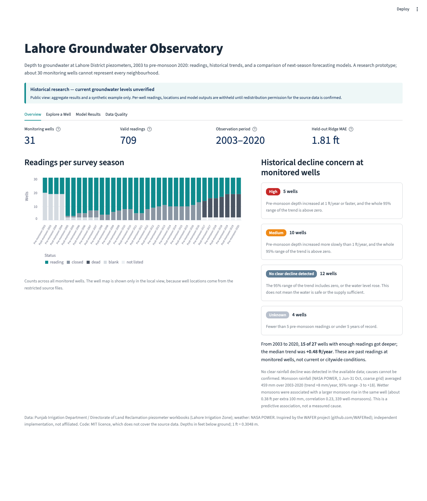
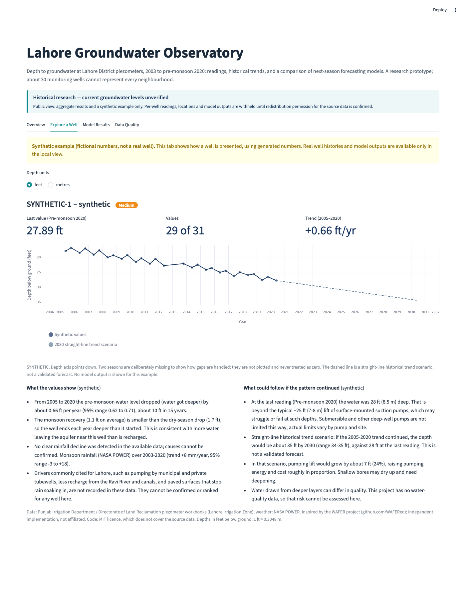
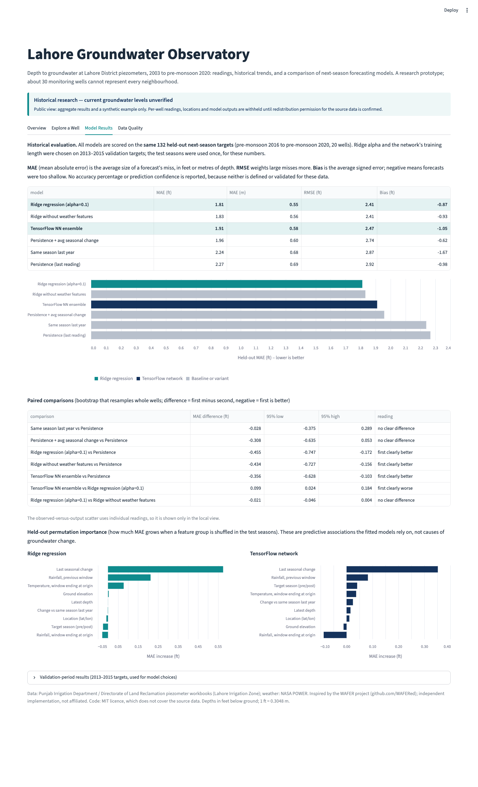
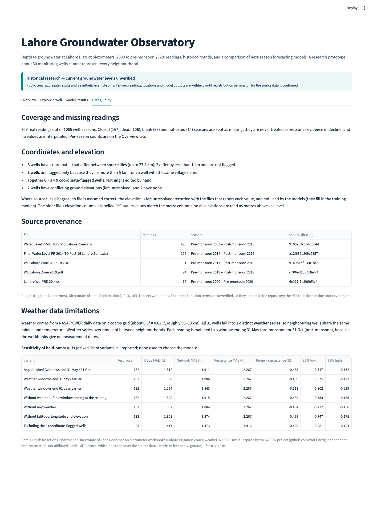

# Lahore Groundwater Observatory (research prototype)

Historical depth to groundwater at Lahore District piezometers, 2003 to pre-monsoon 2020: cleaned
readings, a per-well historical decline summary, and a held-out comparison of **next-season**
forecasting models (simple baselines, ridge regression and a small TensorFlow network).

> **Historical research — current groundwater levels unverified.** All readings end in pre-monsoon
> 2020. Nothing here is a measured or verified *current* groundwater level in Lahore. About 30
> monitoring wells cannot represent every neighbourhood. Model outputs for post-monsoon 2020 have no
> observation to check them against.

**Credit:** the [WAFER project](https://github.com/WAFERed) (World Aquifer Forecast Engine and
Research), which studied groundwater forecasting for Islamabad, inspired this work. This is an
independent implementation written from scratch; no WAFER code is reused. Data: Punjab Irrigation
Department, Directorate of Land Reclamation; weather: NASA POWER.

**Licence:** the code and documentation are under the [MIT License](LICENSE) (Copyright © 2026
Mubashir Ali). The MIT licence does **not** grant any right to redistribute the groundwater data or
other third-party data; see [docs/DATA_POLICY.md](docs/DATA_POLICY.md).

---

## Results at a glance

Held-out test period: 132 next-season forecasts for 20 wells, with targets from pre-monsoon 2016 to
pre-monsoon 2020. Model choices used only the 2003–2015 targets.

| Model | Test MAE (ft) | Test MAE (m) | Test RMSE (ft) | Bias (ft) |
|---|---|---|---|---|
| Ridge regression (predicts seasonal change) | **1.81** | **0.55** | 2.41 | −0.87 |
| Ridge without weather features | 1.83 | 0.56 | 2.41 | −0.93 |
| TensorFlow NN ensemble (5 small MLPs) | 1.91 | 0.58 | 2.47 | −1.05 |
| Persistence + average seasonal change | 1.96 | 0.60 | 2.74 | −0.62 |
| Same season last year | 2.24 | 0.68 | 2.87 | −1.67 |
| Persistence (repeat last reading) | 2.27 | 0.69 | 2.92 | −0.98 |

MAE is the average size of a forecast's miss, in feet (or metres) of depth. It is not an accuracy
percentage, and no prediction confidence is reported because none is defined or validated here.

* Ridge and the network both beat persistence. A paired bootstrap that resamples whole wells
  gives −0.46 ft for ridge (95% interval −0.75 to −0.17) and −0.36 ft for the network (−0.63 to −0.10).
* The network is **worse than ridge** by 0.10 ft (95% interval +0.02 to +0.18), although it was
  marginally better on the validation years. With about 660 samples, the simpler model is preferred.
* **NASA POWER weather does not clearly help.** Ridge with and without weather differs by 0.02 ft,
  and the interval (−0.05 to +0.00) includes zero.
* All models under-predict depth in 2016–2020 (bias about −1 ft): the water table deepened faster
  than in the training years.
* **Historical decline concern at monitored wells** (readings only, no model): 15 of 27 wells with
  enough readings got deeper between 2003 and 2020; the median trend was +0.48 ft/year. 5 wells
  are *High* (deepening 1 ft/year or faster), 10 *Medium*, 12 *No clear decline detected* and
  4 *Unknown*. No clear rainfall decline was detected in the available data; causes cannot be
  confirmed.

Full tables: [reports/results.md](reports/results.md), [reports/sensitivity.md](reports/sensitivity.md),
[reports/data_audit.md](reports/data_audit.md).


---

## Dashboard

```bash
source .venv/bin/activate
streamlit run app/dashboard.py                      # local view (needs the restricted data)
LGO_PUBLIC_MODE=1 streamlit run app/dashboard.py    # public view: aggregates + synthetic example
```

The dashboard has two views:

* **Local view**, when `data/processed/` exists: per-well histories, the well map, next-season
  model outputs and per-well warnings, from your local copy of the restricted data. Use it on your
  own computer; do not deploy it publicly while redistribution permission is unconfirmed.
* **Public view**, when the data is absent (for example a fresh clone) or `LGO_PUBLIC_MODE=1`: it
  reads only publishable files (`reports/public_summary.json`, metrics, comparisons, feature
  importance, sensitivity) and shows no well IDs, locations, readings or model outputs for real wells.
  The *Explore a Well* tab uses a generated well labelled **SYNTHETIC**. A test
  (`tests/test_public.py`) checks the rendered public view for well IDs and coordinates.

| Tab | Local view | Public view |
|---|---|---|
| **Overview** | Cards (wells, valid readings, observation period, held-out ridge MAE), well map coloured by historical decline concern, concern rules | Same cards, readings per survey season, concern counts and rules |
| **Explore a Well** | Tehsil/well selectors or map click; last observed depth with its season, readings, trend, coordinate/elevation warnings; feet/metres; chart of observed readings, next-season model output (unverified) and 2030 straight-line trend scenario; why a forecast is missing | The same layout for a synthetic well, without model output |
| **Model Results** | Historical evaluation: MAE, RMSE, bias on identical held-out targets, paired comparisons, observed versus model output, permutation importance | The same without the per-sample scatter |
| **Data Quality** | Coverage by well and season, coordinate and elevation tables, source files with hashes, weather limits, sensitivity | Counts only, source files with hashes, weather limits, sensitivity |

Observation dates are season and year only; exact survey dates were not recorded.

Screenshots of the public view (produced by `python scripts/capture_screenshots.py --public`; reviewed
for per-well content):

| Overview | Explore a Well (synthetic) |
|---|---|
|  |  |
| **Model Results** | **Data Quality** |
|  |  |

Screenshots of the local view (`python scripts/capture_screenshots.py`) show per-well data and stay
git-ignored. The theme (white background, navy headings, teal accents; red and orange only for
concern levels) is set in `.streamlit/config.toml`; the layout stacks into one column on phones.

---

## Setup (macOS, Apple M1 tested)

```bash
git clone https://github.com/thismubashir/lahore-groundwater-observatory.git
cd lahore-groundwater-observatory
python3 -m venv .venv
source .venv/bin/activate
pip install -r requirements.txt     # TensorFlow 2.21 CPU build; no GPU needed
```

The network is small and trains on a laptop CPU. The first `import tensorflow` after installation
can take about a minute while macOS scans the binaries.

## Running

Activate the virtual environment first, in every new terminal. The libraries are installed only
in `.venv`; the system `python3` has no TensorFlow, so commands fail without it.

```bash
source .venv/bin/activate
python scripts/run_all.py > run_all.log 2>&1   # stages 1, 2, 3 and 5 (about 2–3 min)
python scripts/06_sensitivity.py               # timing/metadata sensitivity (about 5 min)
python scripts/verify_project.py               # 13 checks -> reports/verification.md
python scripts/04_predict.py --well <WELL_ID> ...     # next-season output from saved models
pytest -rs                                     # 53 tests; -rs lists any skipped
streamlit run app/dashboard.py
```

| Stage | Script | Output |
|---|---|---|
| 1 | `01_clean_data.py` | `data/processed/`, local audit in `reports/audit/`, aggregate `reports/data_audit.md` |
| 2 | `02_fetch_weather.py` | NASA POWER cache and seasonal weather per well |
| 3 | `03_train_evaluate.py` | models, metrics, comparisons, importance, `reports/results.md` |
| 4 | `04_predict.py` | next-season output from the saved models, for chosen wells |
| 5 | `05_water_level_risk.py` | historical decline concern per well (local only) and `reports/public_summary.json` (aggregates) |
| 6 | `06_sensitivity.py` | `reports/sensitivity.csv`, `.md` |
| – | `verify_project.py` | `reports/verification.md` (local only) |

### Troubleshooting

* **`ModuleNotFoundError: No module named 'tensorflow'` or `streamlit: command not found`.** The
  virtual environment is not active. Run `source .venv/bin/activate`. In VS Code, choose
  `.venv/bin/python` with *Python: Select Interpreter*.
* **The notebook fails on `import tensorflow`.** Its kernel starts whichever `python` is on the
  PATH. Activate the venv before starting Jupyter, or select the `.venv` interpreter as the kernel.
* **Dashboard shows a `KeyError` or old content after code changes.** Streamlit reloads
  `app/dashboard.py` but not the library modules in `src/`. Stop it with Ctrl+C and start it again.
* **An empty `run_all.log`.** Errors go to the terminal unless `2>&1` is added, as above.
* **The dashboard shows "Public view" although you have the data.** `data/processed/` is missing (run
  the pipeline) or `LGO_PUBLIC_MODE` is set in your shell (`unset LGO_PUBLIC_MODE`).

---

## Repository layout

```
src/lahore_gw/        library code
  raw_loading.py        discover workbooks, detect headers/season columns, DMS -> decimal
  pdf_loading.py        read the 2019 table from the PDF (pdfplumber)
  cleaning.py           Lahore filter, ID verification, overlaps, coordinate and elevation provenance
  weather.py            NASA POWER download, cache and seasonal windows (optional window shift)
  features.py           forecasting samples without look-ahead
  modeling.py           baselines, ridge, TensorFlow ensemble, bootstrap, permutation importance
  prediction.py         next-season output from saved models (validation, version, staleness)
  water_risk.py         historical decline concern per well, trend scenarios, rainfall association
  public_summary.py     aggregate-only summary for the public view (no per-well data)
  synthetic.py          the fictional well shown in the public view
  dashboard_data.py     tested helpers for the dashboard
  plots.py, reporting.py, config.py
scripts/              pipeline stages 01-06, run_all.py, verify_project.py, capture_screenshots.py,
                      optional_grace_comparison.py
app/                  dashboard.py (local view), public_view.py, ui.py (shared); theme in .streamlit/
notebooks/            walkthrough notebook (outputs cleared; run it locally)
reports/              aggregate metrics, comparisons, importance, sensitivity, public summary, figures
docs/                 DATA_POLICY.md, PUBLISHING_CHECKLIST.md, Roman Urdu steps, public screenshots
tests/                pytest suite (synthetic fixtures; real-data tests skip without the data)
.github/              issue and pull-request templates
LICENSE, CITATION.cff, CONTRIBUTING.md, CODE_OF_CONDUCT.md
```

Kept local and git-ignored: `data/raw/`, `data/processed/`, `data/external/`, `models/`,
`reports/audit/`, per-well reports, figures and screenshots (full list in
[docs/PUBLISHING_CHECKLIST.md](docs/PUBLISHING_CHECKLIST.md)).

---

## Data sources

### 1. Piezometer readings (not redistributed here)

Tables of *depth to water table (ft)* at piezometers in the **Lahore Irrigation Zone**, compiled
by the Punjab Irrigation Department's Land Reclamation organisation ("L.R.O., UCC. Lahore"), with
sites identified by GIS and DLR numbers. Their redistribution terms are not verified, so they are
**excluded from this repository**. Request them from the Directorate of Land Reclamation, Lahore,
and place them unchanged in `data/raw/WL-LHR/`:

| File | Content | SHA-256 (first 16 hex) |
|---|---|---|
| `Water Level PR-03 TO Pr-15 Lahore Zone.xlsx` | Pre-2003 … Pre-2015 | `9105a51c1b468344` |
| `Final Water Level PR-2014 TO Post-16 Lahore Zone.xlsx` | Pre-2014 … Post-2016 | `a12f689e209c5357` |
| `WL Lahore Zone 2017-18.xlsx` | Pre-2017 … Post-2018 | `91a9b1af02801bc5` |
| `WL Lahore Zone 2019.pdf` | Pre-2019, Post-2019 (text PDF table) | `d706ed135718ef74` |
| `Lahore WL  PRE-20.xlsx` | Pre-2020 | `6e117f7e896b5fc4` |

The cleaning stage discovers whatever `.xlsx` and `.pdf` files are present, never modifies them,
and checks their hashes before and after cleaning.

### 2. NASA POWER weather (downloaded automatically)

* NASA Langley Research Center POWER Project, Daily API, community `AG`: `PRECTOTCORR`
  (bias-corrected precipitation, mm/day), `T2M` and `T2M_MAX` (°C), 1 Jun 2002 – 31 Dec 2020,
  cached in `data/external/nasa_power/`.
* **Coarse grid:** about 0.5° × 0.625° (50–60 km). All 31 wells fall into **2 distinct weather
  series**, so neighbouring wells share the same weather. Weather varies in time, not between
  neighbourhoods.

---

## Methodology

### Data cleaning ([reports/data_audit.md](reports/data_audit.md))

* **Scope.** Only rows with `District = Lahore` are kept: 31 wells in the Lahore City and Lahore
  Cantt tehsils. Every GIS number maps to exactly one DLR number in every file (the cleaning stops
  otherwise); the ID is `LHR-<GIS no.>`.
* **Missing readings.** `Closed`, `Dead` and blank cells stay missing with a status, never zero and
  never read as decline. Counts: 709 readings, 167 closed, 106 dead, 89 blank, 14 not listed
  (1,085 well-seasons). Nothing is interpolated.
* **Overlaps.** 93 well-season records appear in two files; all agree exactly.
* **Units.** Depth to water is in feet below ground (metres = ft × 0.3048). The older file's
  elevation column says "SEA LEVEL ft", but its values equal the metre columns for 26 of 28 shared
  wells (195–218), so elevations are read as metres above sea level.
* **Elevation conflicts are left unresolved.** No file is assumed correct. When files differ by
  more than 1 m, the elevation used by the models is missing (the training median is filled in)
  and every value is kept, with the files that report it, in the local audit:
  * For one well, the 2003–15 file and the four later files (which repeat one another) disagree by
    36 m, and the later value is far below every other well. Earlier runs used the newest file's
    value; that policy was replaced on 13 October 2026, and the models were retrained.
  * For a second well, the 2003–15 file and the later files disagree by 9 m.
  * Two wells have no elevation in any file.
* **Coordinates: why 8 and 9.** 8 wells have coordinates that differ between files (listed in the
  local audit). Two of them differ by under 1 km and are not flagged, which leaves 6. Three more
  wells are flagged only because they lie more than 5 km from a well with the same village name. So 6 + 3 = **9 coordinate-flagged
  wells**. The latest file's coordinates are shown and nothing is edited by hand.

### Timing assumption and weather windows

The workbooks contain **no measurement dates**. Surveys are conventionally made before the monsoon
(around May–June) and after it (around October–November). The assumption, fixed before any model
was fitted, is that each reading reflects conditions at the end of these windows:

| Reading | Weather window used |
|---|---|
| Pre-monsoon, year Y | 1 Nov (Y−1) – 31 May Y |
| Post-monsoon, year Y | 1 Jun Y – 31 Oct Y |

### Forecasting set-up and leakage control

* One sample pairs a real reading at season *t* with a real reading at the **next** season *t+1*
  (664 samples). Pairs with a gap are not used.
* Features known at the end of season *t*: latest depth; last seasonal change and change against
  the same season last year (with "history available" flags); target season; rainfall and mean
  temperature in the window **ending** at *t*; rainfall in the window before; latitude, longitude
  and ground elevation. Target-window weather is never used.
* Models predict the **change** in depth; the output is the latest depth plus the change.
* Chronological split by target year: train 2003–2012 (409), validation 2013–2015 (123), test
  2016–2020 (132).
* Imputation and scaling are fitted on training rows. Ridge alpha (0.1) and the network's epoch count
  (96, the median early-stopping epoch) are chosen on validation. Models are then refitted on
  train+validation and scored **once** on test.
* Network: 12 inputs → Dense(16, ReLU) → Dropout(0.1) → Dense(8, ReLU) → 1, L2 1e-3, Huber loss,
  Adam; an ensemble of 5 seeds.

### Sensitivity of the held-out results ([reports/sensitivity.md](reports/sensitivity.md))

`scripts/06_sensitivity.py` runs a fixed list of variants. All are reported, and none is used to
choose the model; the published assumptions stay in place even where a variant scores better.

| Variant | Test rows | Ridge MAE (ft) | Network MAE (ft) | Ridge − persistence (ft) [95%] |
|---|---|---|---|---|
| As published | 132 | 1.812 | 1.911 | −0.455 [−0.747, −0.172] |
| Weather windows end 31 days earlier | 132 | 1.808 | 1.906 | −0.459 [−0.750, −0.177] |
| Weather windows end 61 days earlier | 132 | 1.754 | 1.843 | −0.513 [−0.802, −0.229] |
| Without weather of the window ending at the reading | 132 | 1.828 | 1.915 | −0.439 [−0.733, −0.155] |
| Without any weather | 132 | 1.832 | 1.884 | −0.434 [−0.727, −0.156] |
| Without latitude, longitude and elevation | 132 | 1.808 | 1.874 | −0.459 [−0.747, −0.175] |
| Excluding the 9 coordinate-flagged wells | 83 | 1.417 | 1.473 | −0.499 [−0.881, −0.184] |

Ridge stays clearly better than persistence in every variant. The conclusions do not depend on the
assumed window ends or on the disputed metadata.

### Forecasts from saved models

`scripts/04_predict.py` loads the saved preprocessor, networks and ridge model, checks their
feature lists, and produces output **only** for the season after the latest survey (post-monsoon
2020). Wells without a reading in that survey get a reason instead of a number. Each row records
the model version (a hash of the saved files), the data snapshot, and how many years ago the target
season ended. Retraining gives identical weights, but the version hash still changes because Keras
stores a save timestamp; compare predictions, not version strings.

### Feature importance: predictive associations, not causes

Held-out permutation importance shuffles one feature group in the **test** period and measures how
much the MAE grows. Both models rely most on the **last seasonal change** (+0.35 ft for the
network, +0.58 ft for ridge). Previous-window rainfall and temperature come next; they largely act
as season indicators. These are associations the fitted models use. Pumping, canal flows, land use
and river stage are not observed at all.

### Historical decline concern at monitored wells

`scripts/05_water_level_risk.py` and the dashboard use the observed readings only:

* **Trend:** Theil-Sen slope of each well's pre-monsoon depths (one reading per year, so the
  monsoon cycle does not bias it), with an approximate 95% range.
* **Classes:** *High* = deepening at 1 ft/year or faster with the whole 95% range above zero;
  *Medium* = deepening more slowly with the range above zero; *No clear decline detected* = the
  range includes zero, or the water rose (this does **not** mean the water is safe or the supply
  sufficient); *Unknown* = fewer than 5 pre-monsoon readings or under 5 years of record.
* **Seasonal balance:** the average monsoon rise compared with the dry-season fall.
* **Rainfall:** no clear rainfall decline was detected in the available data (monsoon trend
  +8 mm/year, 95% range −3 to +18); causes cannot be confirmed. Wetter monsoons were associated with
  a larger monsoon rise in the same well (about 0.38 ft per extra 100 mm, correlation 0.23,
  339 well-monsoons), which is an association, not a measured cause.
* **2030 values** are straight-line historical trend scenarios, not validated forecasts.
* **25 ft** is shown only as an indicator: surface-mounted suction pumps typically cannot lift water
  from deeper than about 7–8 m. It does not apply to submersible or other deep-well pumps.

### GRACE and the survey template

GRACE/GRACE-FO measures total water storage over roughly 300 km cells, not well depths, so it is
not a model input; `scripts/optional_grace_comparison.py` can plot a user-supplied series for
context. `data/optional/survey_template.csv` is deliberately blank and is not read by the pipeline.

---

## Verification

Run on 13 October 2026 on this computer (Python 3.13.10, TensorFlow 2.21.0, Streamlit 1.65.0):

* **Tests with the local data:** `pytest -rsxX` → **53 passed, 0 skipped, 0 failed**. Earlier
  versions of this README quoted 40 and 45 tests; the suite grew with the new features.
* **Tests in a simulated public clone** (only the files proposed for publication, no data):
  **46 passed, 7 skipped, 0 failed**. The 7 skips are the tests that need the restricted data.
* **`scripts/verify_project.py`:** 13 of 13 checks passed: depth units; missing readings staying
  missing; unresolved elevations; consecutive-season pairing; predictors available at the forecast
  origin; the chronological split; the saved preprocessor fitted without test rows; hyper-parameters
  chosen on validation; saved models reproducing all 132 saved test predictions and the 12 forward
  outputs; raw-to-display traces for two wells (raw workbook cell = processed value = value shown);
  and a missing forecast being explained.
* **Determinism:** consecutive full pipeline runs produced byte-identical `reports/metrics.csv`.
* **Dashboard:** local view — all wells, both tehsils, both units and all model views ran without
  exceptions (Streamlit AppTest), and in headless Chrome all four tabs rendered without errors at
  1400 px and 390 px, and a map click selected the clicked well. Public view — all four tabs rendered
  without errors at both widths, with no well IDs, coordinates or maps.
* **Not repeated:** a rebuild in a fresh virtual environment from `requirements.txt`, and a fresh
  NASA POWER download (cached responses were reused).

---

## Limitations

Historical results are based on observations through pre-monsoon 2020. They do not establish current
Lahore groundwater levels, neighbourhood-wide coverage, drinking-water safety or causal drivers.

* Small and shrinking network: many piezometers are *Closed* (to 2016) or *Dead* (2017 onward), and
  only 12 wells have readings in 2019–2020. The surviving wells may not be representative.
* Measurement dates are unknown, so the weather windows are assumptions (see the sensitivity table).
* Weather is coarse (2 series). No data on pumping, abstraction, canal seepage, the Ravi River, land
  use or aquifer properties, so causes of decline cannot be identified.
* Some coordinates disagree by up to about 28 km, and two elevations are unresolved.
* The test set is small (132 forecasts, 20 wells), so each comparison must be judged by its own
  interval: the 0.10 ft network-versus-ridge gap is distinguishable from zero, while the 0.02 ft
  weather effect is not.
* Forecasts are one season ahead and were evaluated on 2016–2020 only. 2030 values are trend
  scenarios. Nothing is validated for current conditions or for places without a monitoring well.

## Open source and data policy

Lahore Groundwater Observatory's original code and documentation are licensed under the
[MIT License](LICENSE). Third-party datasets and assets have separate terms; the code licence does not
authorise redistribution of source observations.

The public code supports reproducible historical groundwater research. Original measurements,
processed readings, downloaded caches, trained models and per-well exports are excluded from this
initial release; follow [Data sources](#data-sources) to run the complete pipeline locally. The
workbooks' `Address` column, which sometimes names private persons, is never read. See
[docs/DATA_POLICY.md](docs/DATA_POLICY.md) for interpretation and publication boundaries.

## Contributing

Bug fixes, synthetic tests, documentation, accessible visualisations and reproducibility improvements
are welcome. See [CONTRIBUTING.md](CONTRIBUTING.md) and [CODE_OF_CONDUCT.md](CODE_OF_CONDUCT.md).
Please do not attach restricted readings or personal information to public issues.

## Citation and acknowledgement

If you use the software in research, cite this repository and the release or commit used; citation
metadata is in [CITATION.cff](CITATION.cff).

The project is inspired by [WAFER](https://github.com/WAFERed/WAFER). Credit the Punjab Irrigation
Department's source measurements and NASA POWER weather products in work using those datasets,
following their applicable terms. Inspiration credit is not a claim of WAFER affiliation or
endorsement.

## Publishing status

This repository was created from a fresh history containing only reviewed files: no source data,
processed readings, trained models or per-well exports. Redistribution permission for per-well data
has not been confirmed, so the public dashboard view shows aggregates and a synthetic example only.
Open items are listed in [docs/PUBLISHING_CHECKLIST.md](docs/PUBLISHING_CHECKLIST.md).

## Tests

`pytest` runs 53 tests covering season-header parsing, DMS conversion and Closed/Dead/blank handling;
real-file cleaning rules (Lahore only, unique IDs, no zeros, raw files unchanged, unresolved
elevations); conflict detection and elevation provenance; look-ahead and train-only preprocessing;
a TensorFlow fit with save/load round trip; permutation importance; forecasting from saved models
(next season only, explained gaps, rejected inputs, snapshot checks); historical decline concern
rules, scenario maths and wording that never claims a cause; dashboard helpers; and a Streamlit
`AppTest` run of all four tabs in both views, including a check that the public view shows no well
IDs or coordinates. Tests that need the restricted data skip automatically when it is absent.
