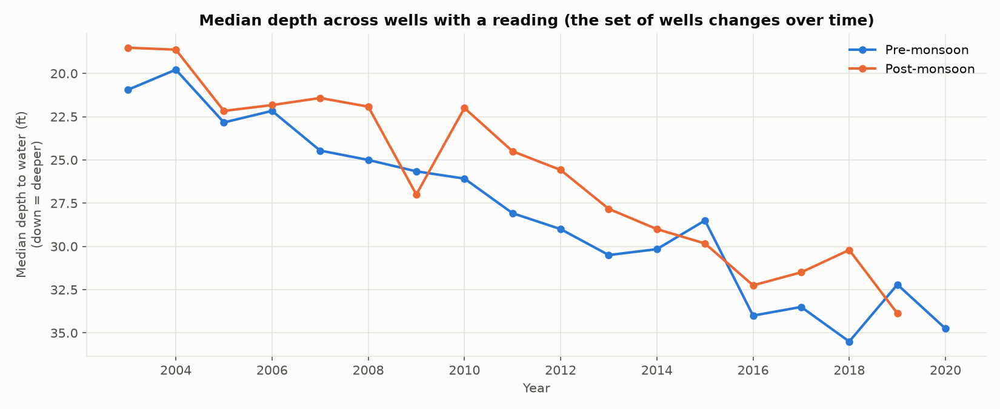

# Data audit (aggregate summary)

Generated by `scripts/01_clean_data.py`. This public summary contains counts only. The full audit with per-well coordinates and coverage is written locally to `reports/audit/data_audit_full.md`, because the source workbooks' redistribution terms are unverified.

## Source files (unchanged, SHA-256 verified before and after cleaning)

| file | sha256 |
|---|---|
| Final Water Level PR-2014 TO Post-16 Lahore Zone.xlsx | a12f689e209c5357… |
| Lahore WL  PRE-20.xlsx | 6e117f7e896b5fc4… |
| WL Lahore Zone 2017-18.xlsx | 91a9b1af02801bc5… |
| WL Lahore Zone 2019.pdf | d706ed135718ef74… |
| Water Level PR-03 TO Pr-15 Lahore Zone.xlsx | 9105a51c1b468344… |

## Scope

* Monitoring locations kept (District = Lahore): **31** in 2 tehsils.
* Seasons covered: **35** (2003–2020); well-season cells: **1085**; real readings: **709** (65%).
* Status counts: {'reading': 709, 'closed': 167, 'dead': 106, 'blank': 89, 'not_listed': 14}. `closed`, `dead`, `blank` = no reading; `not_listed` = absent from that file. None is treated as zero.
* Wells usable for modelling (≥4 readings and ≥2 consecutive-season pairs): **31**.
* GIS↔DLR identifiers one-to-one in every file: **True**.

## Notes

* Overlapping well-season records (present in >1 file): 93; with any disagreement: 0; with different numeric readings: 0
* Elevation headers seen: {'Final Water Level PR-2014 TO Post-16 Lahore Zone.xlsx': 'SEA LEVEL (meter)', 'Lahore WL  PRE-20.xlsx': 'SEA LEVEL (meter)', 'WL Lahore Zone 2017-18.xlsx': 'SEA LEVEL (meter)', 'Water Level PR-03 TO Pr-15 Lahore Zone.xlsx': 'SEA LEVEL ft', 'WL Lahore Zone 2019.pdf': 'SEA LEVEL (meter)'}
* Elevation units: 'SEA LEVEL ft' in Water Level PR-03 TO Pr-15 Lahore Zone.xlsx has the same value as the 'meter' columns for 26 of 28 shared wells (range 195-218). Lahore's ground surface is roughly 200-215 m above sea level, and ~200 ft (61 m) would be impossible, so all elevation values are treated as metres. Elevation (ground surface above sea level) is kept separate from depth to water (below ground).
* Ground elevation: files disagree for **2 wells**; left unresolved and not used by the models.
* Coordinates differ between files for **8 wells** (largest difference 27.8 km); 6 differ by more than 1 km. **9 wells** carry a coordinate flag in total.

## Coverage by season (counts across all wells)

| year | season | wells_listed | readings | closed | dead | blank | not_listed |
|---|---|---|---|---|---|---|---|
| 2003 | pre | 31 | 11 | 0 | 0 | 20 | 0 |
| 2003 | post | 31 | 12 | 0 | 0 | 19 | 0 |
| 2004 | pre | 31 | 12 | 0 | 0 | 19 | 0 |
| 2004 | post | 31 | 12 | 0 | 0 | 19 | 0 |
| 2005 | pre | 31 | 28 | 1 | 0 | 2 | 0 |
| 2005 | post | 31 | 28 | 1 | 0 | 2 | 0 |
| 2006 | pre | 31 | 26 | 3 | 0 | 2 | 0 |
| 2006 | post | 31 | 26 | 3 | 0 | 2 | 0 |
| 2007 | pre | 31 | 24 | 5 | 0 | 2 | 0 |
| 2007 | post | 31 | 24 | 5 | 0 | 2 | 0 |
| 2008 | pre | 31 | 27 | 4 | 0 | 0 | 0 |
| 2008 | post | 31 | 27 | 4 | 0 | 0 | 0 |
| 2009 | pre | 31 | 25 | 6 | 0 | 0 | 0 |
| 2009 | post | 31 | 24 | 7 | 0 | 0 | 0 |
| 2010 | pre | 31 | 23 | 8 | 0 | 0 | 0 |
| 2010 | post | 31 | 23 | 8 | 0 | 0 | 0 |
| 2011 | pre | 31 | 26 | 5 | 0 | 0 | 0 |
| 2011 | post | 31 | 26 | 5 | 0 | 0 | 0 |
| 2012 | pre | 31 | 23 | 8 | 0 | 0 | 0 |
| 2012 | post | 31 | 22 | 9 | 0 | 0 | 0 |
| 2013 | pre | 31 | 21 | 10 | 0 | 0 | 0 |
| 2013 | post | 31 | 20 | 11 | 0 | 0 | 0 |
| 2014 | pre | 31 | 21 | 10 | 0 | 0 | 0 |
| 2014 | post | 31 | 21 | 10 | 0 | 0 | 0 |
| 2015 | pre | 31 | 21 | 10 | 0 | 0 | 0 |
| 2015 | post | 31 | 21 | 10 | 0 | 0 | 0 |
| 2016 | pre | 31 | 20 | 11 | 0 | 0 | 0 |
| 2016 | post | 31 | 18 | 13 | 0 | 0 | 0 |
| 2017 | pre | 29 | 17 | 0 | 12 | 0 | 2 |
| 2017 | post | 29 | 15 | 0 | 14 | 0 | 2 |
| 2018 | pre | 29 | 15 | 0 | 14 | 0 | 2 |
| 2018 | post | 29 | 14 | 0 | 15 | 0 | 2 |
| 2019 | pre | 29 | 12 | 0 | 17 | 0 | 2 |
| 2019 | post | 29 | 12 | 0 | 17 | 0 | 2 |
| 2020 | pre | 29 | 12 | 0 | 17 | 0 | 2 |

