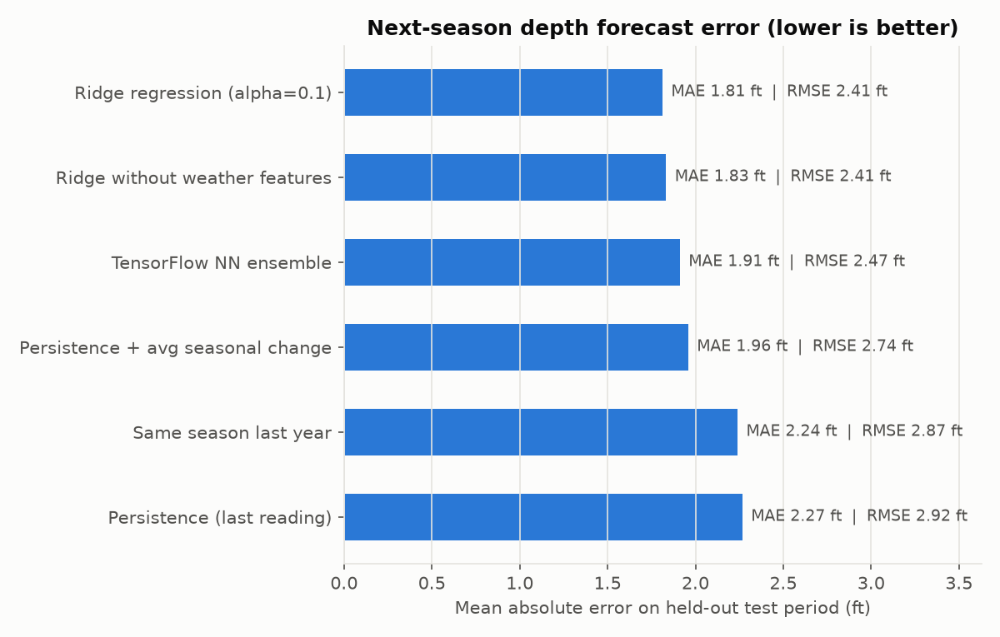
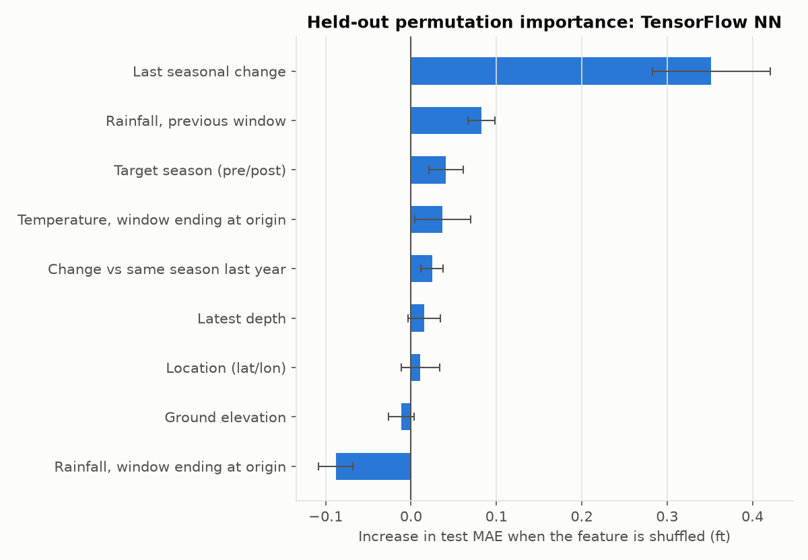

# Results (generated by `scripts/03_train_evaluate.py`)

**Task:** forecast depth to water (ft below ground) at the next observed season
(pre-monsoon -> post-monsoon or post-monsoon -> next pre-monsoon) for Lahore District
piezometers, using only information available at the end of the current season.

## Data splits (chronological, by target year)

| split | samples | wells | first_target | last_target |
|---|---|---|---|---|
| train | 409 | 31 | post-2003 | post-2012 |
| validation | 123 | 23 | pre-2013 | post-2015 |
| test | 132 | 20 | pre-2016 | pre-2020 |

Ridge alpha chosen on validation: **0.1**. NN epochs chosen on validation: **96**
(early stopping), then all models were refitted on train+validation and evaluated once on test.

## Errors

| model | split | n | mae_ft | rmse_ft | mae_m | rmse_m | bias_ft |
|---|---|---|---|---|---|---|---|
| Persistence (last reading) | validation | 123 | 2.419 | 2.934 | 0.737 | 0.894 | -0.142 |
| Same season last year | validation | 123 | 1.471 | 1.904 | 0.448 | 0.58 | -0.301 |
| Persistence + avg seasonal change | validation | 123 | 1.661 | 2.192 | 0.506 | 0.668 | -0.018 |
| Ridge regression (alpha=0.1) | validation | 123 | 1.259 | 1.634 | 0.384 | 0.498 | -0.036 |
| Ridge without weather features | validation | 123 | 1.293 | 1.688 | 0.394 | 0.514 | -0.028 |
| TensorFlow NN ensemble | validation | 123 | 1.221 | 1.602 | 0.372 | 0.488 | -0.028 |
| Persistence (last reading) | test | 132 | 2.267 | 2.918 | 0.691 | 0.889 | -0.985 |
| Same season last year | test | 132 | 2.239 | 2.867 | 0.682 | 0.874 | -1.671 |
| Persistence + avg seasonal change | test | 132 | 1.958 | 2.745 | 0.597 | 0.837 | -0.617 |
| Ridge regression (alpha=0.1) | test | 132 | 1.812 | 2.407 | 0.552 | 0.734 | -0.874 |
| Ridge without weather features | test | 132 | 1.832 | 2.406 | 0.559 | 0.733 | -0.933 |
| TensorFlow NN ensemble | test | 132 | 1.911 | 2.468 | 0.582 | 0.752 | -1.048 |

Best test MAE: **Ridge regression (alpha=0.1)** with 1.81 ft (0.55 m).
Persistence: 2.27 ft. TensorFlow NN: 1.91 ft (0.58 m).

### Paired comparisons (cluster bootstrap by well, test period)

`mae_difference_ft` = MAE(first model) - MAE(second model); negative means the first is better.
`clearly_better` = the whole 95% interval is below zero.

| model | mae_difference_ft | ci95_low | ci95_high | clearly_better |
|---|---|---|---|---|
| Same season last year vs Persistence | -0.028 | -0.375 | 0.289 | False |
| Persistence + avg seasonal change vs Persistence | -0.308 | -0.635 | 0.053 | False |
| Ridge regression (alpha=0.1) vs Persistence | -0.455 | -0.747 | -0.172 | True |
| Ridge without weather features vs Persistence | -0.434 | -0.727 | -0.156 | True |
| TensorFlow NN ensemble vs Persistence | -0.356 | -0.628 | -0.103 | True |
| TensorFlow NN ensemble vs Ridge regression (alpha=0.1) | 0.099 | 0.024 | 0.184 | False |
| Ridge regression (alpha=0.1) vs Ridge without weather features | -0.021 | -0.046 | 0.004 | False |

**Honest reading.** The network beats persistence (95% interval of the MAE difference is below zero: -0.63 to -0.10 ft). It is slightly but consistently WORSE than the much simpler ridge regression (difference +0.10 ft, 95% interval 0.02 to 0.18 ft), even though it looked marginally better on the validation years; the extra complexity is not justified by these data. Adding NASA POWER weather does not clearly improve ridge regression (difference -0.02 ft, 95% interval -0.05 to 0.00 ft). With 132 test samples from
20 wells, judge each difference by its interval in the table above, not
by its size. All models under-predict depth in the test period (negative bias):
water tables deepened faster in 2016–2020 than the training years suggested.

## Held-out feature importance (permutation on the test period)

TensorFlow NN:

| feature_group | mae_increase_ft | std_ft |
|---|---|---|
| Last seasonal change | 0.352 | 0.069 |
| Rainfall, previous window | 0.082 | 0.016 |
| Target season (pre/post) | 0.041 | 0.02 |
| Temperature, window ending at origin | 0.037 | 0.033 |
| Change vs same season last year | 0.025 | 0.013 |
| Latest depth | 0.015 | 0.019 |
| Location (lat/lon) | 0.011 | 0.022 |
| Ground elevation | -0.012 | 0.015 |
| Rainfall, window ending at origin | -0.088 | 0.02 |

Ridge regression:

| feature_group | mae_increase_ft | std_ft |
|---|---|---|
| Last seasonal change | 0.575 | 0.094 |
| Rainfall, previous window | 0.213 | 0.05 |
| Temperature, window ending at origin | 0.078 | 0.04 |
| Ground elevation | 0.004 | 0.003 |
| Latest depth | -0.0 | 0.018 |
| Change vs same season last year | -0.001 | 0.007 |
| Location (lat/lon) | -0.008 | 0.004 |
| Target season (pre/post) | -0.025 | 0.036 |
| Rainfall, window ending at origin | -0.028 | 0.013 |

Importance shows what the fitted model *relies on* for these held-out seasons: a predictive
association. It does not prove that a factor *causes* groundwater change: features are correlated (e.g.
rainfall and temperature share the same coarse grid cell and season), and a model can
lean on proxies. Negative or near-zero values mean "no measurable reliance".

## Forward forecast

12 wells have a reading in the last available season, giving an
**unverified** forecast for the following season (see dashboard). These are model
outputs for a historical season, not current (2026) groundwater levels, and they do
not cover every Lahore neighbourhood.

Per-well figures (`figures/test_forecast_vs_observed.png`, `figures/test_change_forecast_vs_observed.png`)
are written locally and not committed; see docs/DATA_POLICY.md.
